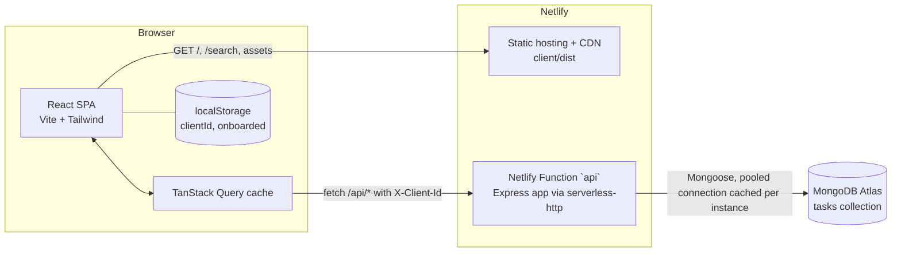
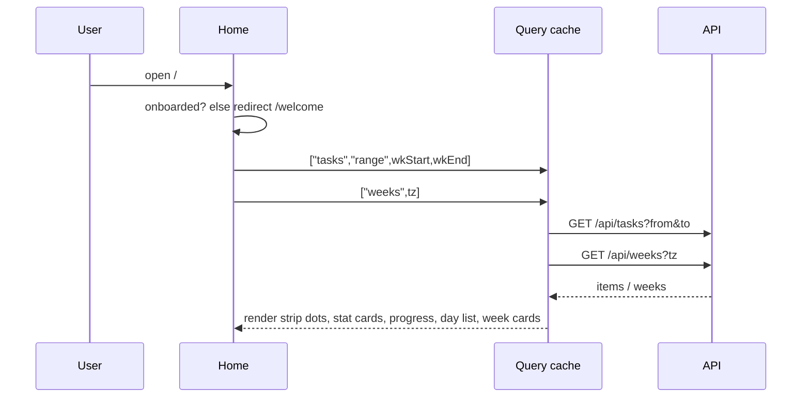

# To Do List App: System Design

**Date**: 2026-11-11
**Source requirement**: `SDE I - Assessment.pdf` (SDE 1, MERN stack assignment)
**Design source**: public Figma file "To Do List Mobile app", Page 1, frames `Onboarding`, `Home`, `New Task`, `Frame 9` (search). Screenshots: [docs/figma/](figma/)
**Build spec**: [docs/specs/0001-todo-app/index.md](specs/0001-todo-app/index.md) (acceptance criteria, UI spec, build plan)

---

## 1. Summary

You are building a mobile first web app for to do tasks. Users create, edit, delete, search and complete tasks. Each task has a date and a start time. Tasks are grouped into weeks that run Monday to Sunday, and each week shows how many tasks are open and how many are completed.

The app is a classic MERN build (MongoDB, Express, React, Node) in one repository. The React app and the Express API ship together in one Netlify deploy: the React build is served as static files, and Express runs inside a Netlify Function at `/api`. There is no login. Each browser gets an anonymous id, so every visitor sees only their own tasks.

---

## 2. Requirements recap

### 2.1 Functional (from the PDF)

| ID | Requirement | PDF section |
|---|---|---|
| FR-1 | Create a task: title (required), description (optional), date and time (required), priority Low/Medium/High (optional) | 3.1 |
| FR-2 | Edit any task attribute | 3.1 |
| FR-3 | Delete a task (swipe left, then tap Delete) | 3.1, 4.4 |
| FR-4 | Search tasks by keyword over title and description; view, edit or delete from results | 3.1, 4.5 |
| FR-5 | Group tasks by week, Monday to Sunday | 3.2 |
| FR-6 | Each week card shows open count and completed count; tapping it expands to show that week's tasks | 3.2 |
| FR-7 | Mark a task Completed or In Progress; the week card updates | 3.3 |
| FR-8 | Fully responsive mobile UI that follows the Figma (Tailwind allowed) | Build note |
| FR-9 | Submit a GitHub repo plus a Netlify deploy that uses your own API | Build note |

### 2.2 Non functional (decided here)

| Area | Target |
|---|---|
| Latency | API p95 under 300 ms warm, first call after idle under about 2.5 s (function cold start plus Mongo connect) |
| Scale | Demo scale: tens of concurrent users, up to a few thousand tasks per client. No design for more is needed. |
| Availability | Whatever Netlify plus MongoDB Atlas free tier give. No SLA. |
| Responsive | Works from 320 px to 1440 px wide with no horizontal scroll |
| Accessibility | Keyboard reachable, labelled controls, focus trapped in dialogs, WCAG AA text contrast |
| Data safety | No secrets in code, input validated at the API, no cross client data access |

---

## 3. Gaps and conflicts, and how they are resolved

The PDF and the Figma disagree in a few places, and both leave some things open. Each item below is a decision, so the build does not have to guess.

| # | Gap or conflict | Decision |
|---|---|---|
| G-1 | PDF wants week **cards** that expand. Figma Home shows **one** week (day strip, two stat cards, "Tasks Today"). | Keep the Figma Home for the selected week, and add an **All weeks** section under "Tasks Today" with one expandable card per week. "View All" scrolls there and expands the selected week. |
| G-2 | Figma day strip shows **Sun 09 to Sun 16** (8 days). PDF says weeks are **Mon to Sun**. | The strip shows 7 days, **Mon to Sun**. A small row above it shows the week range with previous and next week buttons. |
| G-3 | PDF says "Date & Time (mandatory)". Figma form has **Start**, **Ends** and **Set Date**. | Date and Start are required. Ends is optional and must be later than Start on the same day. The task's week comes from its start. |
| G-4 | PDF lists **Priority**. The Figma form has no priority field. | Add a Low / Medium / High segmented control to the form, styled with the Figma tokens. Rows show a small text chip when a priority is set. |
| G-5 | PDF has no login. A public demo with one shared list lets reviewers overwrite each other. | Anonymous client id: a UUID made once per browser, stored in `localStorage`, sent on every API call as `X-Client-Id`. |
| G-6 | Figma's New Task background shows a header with settings, search and bell icons. No requirement uses settings or notifications. | Not built. Home uses the search bar header from the Home frame. Icons that do nothing would be misleading. |
| G-7 | Figma search results show only a checkbox and title. PDF needs view, edit and delete from results. | Search reuses the Home task row (checkbox, title, delete, edit, swipe to delete, tap to view) and adds a small muted date line, because results span many weeks. |
| G-8 | "Open" (PDF) vs "Pending" (Figma) vs "In Progress" (PDF 3.3). | One status field: `in_progress` (shown as Pending/Open) or `completed`. |
| G-9 | Figma onboarding has no rule for when it shows. | Show it on first visit only. "Get Started" sets a `localStorage` flag. |
| G-10 | Which time zone defines "Monday"? | The viewer's device time zone (IANA name from `Intl`), sent to the API where grouping happens. |

---

## 4. Architecture overview



**How a request flows**

1. The browser loads the SPA from the Netlify CDN. Netlify rewrites every unknown path to `/index.html`, so client routes like `/search` work on refresh.
2. The SPA calls relative URLs under `/api`. Netlify rewrites `/api/*` to the `api` function, so the app and API share one origin and no CORS setup is needed.
3. The function wraps one Express app. On a cold start it opens a Mongoose connection and caches it on the module scope, so warm calls reuse it.
4. Every data route reads `X-Client-Id`, validates it, and filters every query by it.

**Why one deployable**: the PDF asks for a Netlify deploy with your own API. Running Express as a Netlify Function keeps one repo, one URL, one deploy and one set of env vars. The same Express app also runs as a normal Node server for local development and tests. The full option comparison is in [rationale.md](specs/0001-todo-app/rationale.md).

---

## 5. Tech stack

| Layer | Choice | Notes |
|---|---|---|
| Language | TypeScript (strict) in client, server and function | |
| Frontend | React (current major) with Vite | SPA, no SSR needed (no SEO surface) |
| Routing | React Router (library mode) | 3 routes plus URL driven task sheet |
| Server state | TanStack Query v5 | Caching, invalidation, optimistic status toggle, infinite search |
| Styling | Tailwind CSS v4 with design tokens in `@theme` | Tokens from the Figma, see spec UI section |
| Icons | `lucide-react` | Outline icons that match the Figma style |
| Font | Poppins 400/500/600 from Google Fonts | Matches the Figma visually. Exact font name is unverified because Figma Dev Mode needs a login. |
| Dates | Native `Date` and `Intl.DateTimeFormat`, no date library | Week math is a few lines; see section 7 |
| API | Node 20+ with Express | JSON REST |
| Validation | `zod` on the server; same rules mirrored in the form | |
| ODM | Mongoose | Schema, indexes, aggregation |
| Database | MongoDB Atlas, free M0 cluster (MongoDB 7 or later) | Needs 5.0+ for `$dateTrunc` |
| Serverless adapter | `serverless-http` | Wraps Express for the Netlify Function |
| Rate limit | `express-rate-limit` | In memory, per function instance |
| Tests | Vitest, Supertest, `mongodb-memory-server` | |
| Hosting | Netlify (static site plus Functions) | One deploy |
| Repo | npm workspaces: `client`, `server` | |

---

## 6. Repository layout

```
todo-app/
  package.json              # workspaces: ["client", "server"], root scripts (dev, build, test)
  netlify.toml              # build, functions dir, redirects, headers
  netlify/
    functions/
      api.ts                # serverless-http wrapper around server/src/app.ts
  server/
    package.json
    tsconfig.json
    .env.example            # MONGODB_URI=, PORT=4000
    src/
      app.ts                # createApp(): express app, routes, error handler (no listen)
      local.ts              # app.listen for local dev
      db.ts                 # connectDb(): cached mongoose connection
      clientId.ts           # middleware: read + validate X-Client-Id
      errors.ts             # HttpError, error handler, error JSON shape
      tasks/
        task.model.ts       # Mongoose schema + indexes
        task.schemas.ts     # zod: create, patch, range query, search query, weeks query
        task.routes.ts      # /tasks routes
        weeks.routes.ts     # /weeks aggregation
        serialize.ts        # db doc -> API Task JSON
    test/
      tasks.test.ts
      weeks.test.ts
  client/
    package.json
    index.html
    vite.config.ts          # react plugin, tailwind plugin, dev proxy /api -> :4000
    src/
      main.tsx              # QueryClientProvider, RouterProvider, Toaster
      index.css             # @import "tailwindcss"; @theme tokens; Poppins
      api/
        client.ts           # fetch wrapper: base /api, X-Client-Id, JSON, ApiError
        tasks.ts            # typed calls + query keys + hooks
      lib/
        week.ts             # startOfWeek, addDays, dayKey, combineDateTime, formatters
        week.test.ts
        clientId.ts         # get or create UUID in localStorage
      routes/
        Onboarding.tsx
        Home.tsx
        Search.tsx
      components/
        SearchBar.tsx  WeekStrip.tsx  StatCard.tsx  WeeklyProgress.tsx
        TaskRow.tsx    TaskList.tsx   WeekCard.tsx  AllWeeks.tsx  Fab.tsx
        TaskSheet.tsx  TaskForm.tsx   TaskDetails.tsx  ConfirmDialog.tsx  Toaster.tsx
        icons/Zigzag.tsx            # onboarding decoration (inline SVG)
  README.md                 # setup, env, scripts, deploy, live URL
```

---

## 7. Data model

### 7.1 Collection `tasks`

| Field | Type | Required | Rules |
|---|---|---|---|
| `_id` | ObjectId | yes | Primary key. Exposed as `id` (string). |
| `clientId` | string | yes | UUID v4 from `X-Client-Id`. Never returned by the API. |
| `title` | string | yes | Trimmed, 1 to 120 chars |
| `description` | string | no | Trimmed, up to 1000 chars, default `""` |
| `startAt` | Date | yes | Instant (UTC) of the chosen date plus start time in the user's time zone |
| `endAt` | Date or null | no | If set: later than `startAt` and less than 24 h after it |
| `priority` | `"low"` / `"medium"` / `"high"` / null | no | Default `null` |
| `status` | `"in_progress"` / `"completed"` | yes | Default `"in_progress"` |
| `createdAt`, `updatedAt` | Date | auto | Mongoose `timestamps: true` |

**Index**: `{ clientId: 1, startAt: 1 }`. It serves the week range query, the weeks aggregation `$match`, and the search sort. No other index is needed at this scale.

**Deletion**: hard delete. Nothing references a task, and there is no undo requirement.

**Relationships**: none. There is no user collection: `clientId` is the owner.

### 7.2 Derived values (never stored)

| Value | Derived from |
|---|---|
| Week of a task | Monday 00:00 of `startAt` in the viewer's time zone |
| Open count | Tasks in the week with `status = "in_progress"` |
| Completed count | Tasks in the week with `status = "completed"` |
| Progress | `completed / total`, 0 when `total = 0` |

Storing a `weekStart` field would be wrong: the same instant is in a different week for a viewer in another time zone, and it would go stale when `startAt` changes.

### 7.3 Status lifecycle

```
          create
            |
            v
     +-------------+   check    +-----------+
     | in_progress | ---------> | completed |
     |  (Pending)  | <--------- |           |
     +-------------+  uncheck   +-----------+
            \                       /
             \------- delete ------/   (hard delete, terminal)
```

Both directions are allowed at any time by the owner.

---

## 8. Time and week logic

This is the part most likely to be subtly wrong, so it is pinned down here.

**Creating or editing a task (client)**
- The form holds `date` (`YYYY-MM-DD`), `startTime` (`HH:mm`) and optional `endTime` (`HH:mm`) from native inputs.
- `startAt = new Date(\`${date}T${startTime}\`)` is parsed as **local** time by the browser, then sent as `toISOString()` (UTC).
- `endAt` is built the same way from the same `date`.
- When editing, the form splits `startAt` back into local `date` and `startTime`.

**Week range for one week (client)**
```ts
// lib/week.ts (sketch)
export function startOfWeek(d: Date): Date {        // Monday 00:00 local
  const x = new Date(d); x.setHours(0, 0, 0, 0);
  x.setDate(x.getDate() - ((x.getDay() + 6) % 7));  // Sun(0) -> 6 days back
  return x;
}
export const addDays = (d: Date, n: number) => { const x = new Date(d); x.setDate(x.getDate() + n); return x; };
// range for a week: [startOfWeek(d), addDays(startOfWeek(d), 7))  -> sent as from/to ISO
```
`setDate` moves by calendar days in local time, so weeks that contain a daylight saving change are still exactly Monday 00:00 to next Monday 00:00 local.

**All weeks summary (server)**
```js
Task.aggregate([
  { $match: { clientId } },
  { $group: {
      _id: { $dateTrunc: { date: "$startAt", unit: "week", startOfWeek: "monday", timezone: tz } },
      total: { $sum: 1 },
      completed: { $sum: { $cond: [{ $eq: ["$status", "completed"] }, 1, 0] } }
  } },
  { $project: { _id: 0, weekStart: "$_id", total: 1, completed: 1, open: { $subtract: ["$total", "$completed"] } } },
  { $sort: { weekStart: 1 } }
])
```
- `tz` is an IANA name (for example `Asia/Kolkata`) that the client reads from `Intl.DateTimeFormat().resolvedOptions().timeZone`. The server validates it with `new Intl.DateTimeFormat("en", { timeZone: tz })` inside `try`, and returns 400 if it throws.
- `weekStart` from the server and `startOfWeek()` on the client are the same instant, so the client matches them with `getTime()`.

**Boundary examples (these become tests)**

| Task local time (Asia/Kolkata) | Week |
|---|---|
| Sun 16 Nov 2025, 23:30 | Mon 10 Nov to Sun 16 Nov |
| Mon 17 Nov 2025, 00:00 | Mon 17 Nov to Sun 23 Nov |
| Sun 2 Nov 2025, 01:30 in America/New_York (DST ends) | Mon 27 Oct to Sun 2 Nov |

---

## 9. API design

**Base path**: `/api` (same origin). JSON only. Request body limit 10 kB.

**Header on every data route**: `X-Client-Id: <uuid v4>`. Missing or not a UUID returns `400 BAD_REQUEST`.

**Task JSON**
```json
{
  "id": "6731f0c2a1b2c3d4e5f60789",
  "title": "Finishing Wireframe",
  "description": "",
  "startAt": "2025-11-12T04:30:00.000Z",
  "endAt": null,
  "priority": "high",
  "status": "in_progress",
  "createdAt": "2025-11-10T09:00:00.000Z",
  "updatedAt": "2025-11-10T09:00:00.000Z"
}
```

**Error JSON** (every non 2xx)
```json
{ "error": { "code": "VALIDATION_ERROR", "message": "Invalid task", "fields": { "title": "Title is required" } } }
```
Codes: `BAD_REQUEST` 400, `VALIDATION_ERROR` 400, `NOT_FOUND` 404, `RATE_LIMITED` 429, `INTERNAL` 500. A 500 never leaks a stack trace.

### 9.1 Endpoints

| Method | Path | Input | Success | Errors |
|---|---|---|---|---|
| GET | `/api/health` | none (no client id) | `200 { ok: true, db: "up" \| "down" }` | |
| GET | `/api/tasks` | query `from`, `to` (ISO, required, `to > from`, span at most 42 days) | `200 { items: Task[] }` sorted by `startAt` then `_id`, capped at 500 | 400 |
| GET | `/api/tasks/search` | query `q` (trimmed, 1 to 100 chars), `limit` (1 to 50, default 20), `cursor` (opaque, optional) | `200 { items: Task[], nextCursor: string \| null }` | 400 |
| GET | `/api/tasks/:id` | path id | `200 Task` | 404 (bad id, missing, or another client's) |
| POST | `/api/tasks` | body `{ title, description?, startAt, endAt?, priority? }` | `201 Task` | 400 |
| PATCH | `/api/tasks/:id` | body: any subset of `{ title, description, startAt, endAt (nullable), priority (nullable), status }` | `200 Task` | 400, 404 |
| DELETE | `/api/tasks/:id` | path id | `204` | 404 |
| GET | `/api/weeks` | query `tz` (IANA, required) | `200 { weeks: [{ weekStart, open, completed, total }] }` ascending | 400 |

**Rules that apply to several routes**
- Every query includes `{ clientId }`. A task owned by another client is reported as 404, never 403, so ids cannot be probed.
- An id that is not a valid ObjectId returns 404.
- Unknown body fields are stripped. Fields with the wrong type fail validation, which also blocks operator injection like `{ "title": { "$gt": "" } }`.
- PATCH validates the **merged** result (stored task plus patch), so a patch that moves `startAt` past the stored `endAt` is rejected.
- Search builds a case insensitive regex from `q` with regex special characters escaped, matched against `title` or `description`. Sort is `startAt` ascending, `_id` ascending. The cursor is base64 of `startAt|_id` of the last item, decoded into `{ $or: [{ startAt: { $gt } }, { startAt: equal, _id: { $gt } }] }`.
- `GET /api/weeks` is not paginated. A client has one entry per week that has tasks (about 52 a year).

### 9.2 Example calls

```http
POST /api/tasks
X-Client-Id: 0b7c2f1e-6a1d-4c55-9a43-3a1a6f1c2d9e
Content-Type: application/json

{ "title": "Doing Homework", "startAt": "2026-01-14T04:30:00.000Z", "endAt": "2026-01-14T06:00:00.000Z", "priority": "medium" }
```
```http
GET /api/tasks?from=2026-01-11T18:30:00.000Z&to=2026-01-18T18:30:00.000Z
GET /api/weeks?tz=Asia%2FKolkata
GET /api/tasks/search?q=finish&limit=20
PATCH /api/tasks/6731f0c2a1b2c3d4e5f60789   { "status": "completed" }
```

---

## 10. Frontend architecture

### 10.1 Routes

| Path | Screen | Notes |
|---|---|---|
| `/welcome` | Onboarding | Shown when `localStorage["todo.onboarded"]` is not `"1"` |
| `/` | Home | Redirects to `/welcome` on first visit |
| `/search` | Search | Search input autofocused |
| any of the above + `?sheet=new[&date=YYYY-MM-DD]` | Add task sheet over the screen | `date` defaults to the selected day |
| `...?sheet=view&id=<id>` | Task details sheet | |
| `...?sheet=edit&id=<id>` | Edit task sheet | |

The sheet is driven by URL search params, so the phone's back button closes it and it works from Home and Search alike.

### 10.2 Server state (TanStack Query)

| Query key | Fetches | Used by |
|---|---|---|
| `["tasks", "range", fromISO, toISO]` | `GET /api/tasks?from&to` | Home (selected week), each expanded week card |
| `["tasks", "search", q]` (infinite) | `GET /api/tasks/search` | Search |
| `["tasks", "one", id]` | `GET /api/tasks/:id` (seeded from any cached list) | View and edit sheets |
| `["weeks", tz]` | `GET /api/weeks?tz` | All weeks section |

- **After any create, edit or delete**: invalidate `["tasks"]` and `["weeks"]`.
- **Status toggle** is optimistic: in `onMutate`, cancel `["tasks"]` queries, snapshot them, and flip the task's status in every cached list with `setQueriesData`. Home's stat cards and progress bar are derived from the cached week list, so they change instantly. On error, restore the snapshot and show a toast. On settle, invalidate `["tasks"]` and `["weeks"]`.
- Defaults: `staleTime` 30 s, `retry` 1 for queries, 0 for mutations, `refetchOnWindowFocus` on.

### 10.3 UI state (local)

- `selectedDate` on Home (default today). Changing week moves it to the same weekday in the new week.
- `expandedWeeks: Set<number>` (week start timestamps) in All weeks.
- `openSwipeRowId`: only one row can be swiped open at a time.

### 10.4 Interaction details

- **Swipe to delete**: pointer events on the row content. Horizontal drag translates the row up to 88 px left and reveals a red **Delete** button. Release past 44 px snaps open, otherwise it snaps closed. `touch-action: pan-y` keeps vertical scrolling native. Tapping Delete deletes with no confirm (the swipe was the deliberate action).
- **Trash icon**: opens a confirm dialog ("Delete this task?", Cancel / Delete). This is the keyboard and desktop path.
- **Dialogs**: the native `<dialog>` element with `showModal()` gives focus trapping, Esc to close and a backdrop for free. The sheet has a fixed header, a scrolling body and a sticky footer, so the primary button is always visible.
- **Date and time inputs**: native `<input type="date">` and `<input type="time">`, which open the phone's own pickers. They are styled to look like the Figma fields, and the date field shows a formatted label ("Friday 14, January") over the native input.

---

## 11. Key flows

### 11.1 Home load



### 11.2 Create task

```mermaid
sequenceDiagram
  participant U as User
  participant S as TaskSheet
  participant A as API
  participant Q as Query cache
  U->>S: tap FAB (+)  -> ?sheet=new&date=selected
  U->>S: fill title, start, (end), date, (priority), (description)
  U->>S: tap "Create task"
  S->>S: validate (same rules as server); show field errors or continue
  S->>A: POST /api/tasks (button disabled while pending)
  A-->>S: 201 Task
  S->>Q: invalidate ["tasks"], ["weeks"]
  S->>S: close sheet, toast "Task created", select the task's date
```

### 11.3 Toggle status

Checkbox click, optimistic flip in cache, `PATCH { status }`, then invalidate. On failure, roll back and toast "Could not update task".

### 11.4 Search

Typing updates `q` after a 300 ms debounce. An empty `q` shows a hint, not a request. Results render with the shared `TaskRow`. "Load more" appears when `nextCursor` is not null.

---

## 12. Security

| Concern | Handling |
|---|---|
| Identity | Anonymous `X-Client-Id`. This is **data separation, not authentication**: anyone who copies the id sees those tasks. Acceptable for an unauthenticated demo with no personal data. |
| Cross client access | Every query filters by `clientId`. Other clients' tasks return 404. Tested. |
| Injection | zod type checks reject objects where strings are expected. Search input is regex escaped. No `$where` or raw query strings. |
| XSS | React escapes output. No `dangerouslySetInnerHTML`. |
| Abuse | `express-rate-limit` at 120 requests per minute per IP, per function instance. JSON body limit 10 kB. |
| Secrets | `MONGODB_URI` only in Netlify env and a git ignored `server/.env`. A committed `.env.example` holds placeholders. |
| Database network | Netlify Functions have no fixed outbound IP, so the Atlas allowlist is `0.0.0.0/0`. The protection is a dedicated database user with a long random password and access only to this database. |
| Headers | `netlify.toml` sets `X-Content-Type-Options: nosniff`, `Referrer-Policy: strict-origin-when-cross-origin`, `X-Frame-Options: DENY`. |

---

## 13. Error handling and edge cases

| Case | Behaviour |
|---|---|
| Title empty or only spaces | Inline "Title is required"; no request sent. Server returns 400 as well. |
| End time not after start | Inline "End time must be after start time" |
| Double tap on "Create task" | Button disabled and shows a spinner while the request runs, so no duplicates |
| Delete a task that is already gone (other tab) | 404, toast "Task was already deleted", refetch |
| Edit a task that is already gone | 404, close the sheet, toast, refetch |
| Two tabs edit the same task | Last write wins. No conflict detection at this scale. |
| API down or offline | Lists keep cached data. Failed loads show an inline error with Retry. Failed mutations show a toast. |
| Cold start delay | Skeleton rows and skeleton stat cards; no spinner over the full screen |
| Week with no tasks | Stat cards show `00`, progress shows an empty track, day list shows "No tasks for this day" |
| No tasks at all | All weeks shows "No tasks yet. Tap + to add your first one." |
| Search with no match | "No tasks match "<q>"" |
| `localStorage` unavailable (strict private mode) | Use an in memory id for the session and show a one time notice that tasks will not be kept after reload |
| User clears site data | A new client id is created, so the old tasks are no longer reachable. Accepted tradeoff of having no login. |
| User changes time zone | Weeks are recomputed on next load with the new zone |
| Invalid `tz` | 400; the client falls back to `"UTC"` and retries once |

---

## 14. Performance and scale

- Week view loads at most 2 small requests (one week range, one weeks summary). Both hit the `{ clientId, startAt }` index.
- Search uses an unanchored, case insensitive regex, which scans that client's tasks. With a few thousand tasks per client this is a few milliseconds. If it ever grows, the upgrade is a MongoDB Atlas Search index.
- The function caches its Mongo connection (`maxPoolSize: 5`, `serverSelectionTimeoutMS: 5000`, `bufferCommands: false`), so warm calls skip the connect.
- The rate limiter is in memory per instance, so the limit is loose across instances. A shared store would fix that if abuse ever happens.
- No caching layer, no queue, no CDN rules beyond Netlify defaults. Nothing has been measured that needs them.

---

## 15. Deployment and environments

### 15.1 `netlify.toml`

```toml
[build]
  command = "npm ci && npm run build -w client"
  publish = "client/dist"

[functions]
  directory = "netlify/functions"
  node_bundler = "esbuild"
  external_node_modules = ["mongoose"]

[[redirects]]
  from = "/api/*"
  to = "/.netlify/functions/api/:splat"
  status = 200

[[redirects]]
  from = "/*"
  to = "/index.html"
  status = 200

[[headers]]
  for = "/*"
  [headers.values]
    X-Content-Type-Options = "nosniff"
    X-Frame-Options = "DENY"
    Referrer-Policy = "strict-origin-when-cross-origin"
```

### 15.2 Function entry

```ts
// netlify/functions/api.ts (sketch)
import serverless from "serverless-http";
import { createApp } from "../../server/src/app";
import { connectDb } from "../../server/src/db";

const run = serverless(createApp());
export const handler = async (event: any, context: any) => {
  context.callbackWaitsForEmptyEventLoop = false;
  await connectDb();               // cached after the first call
  return run(event, context);
};
```
Express mounts its router on both `/api` and `/.netlify/functions/api`, so routing works whichever path the platform passes in. Confirm this in the first deploy smoke test (`GET /api/health`).

### 15.3 Environment variables

| Name | Where | Purpose |
|---|---|---|
| `MONGODB_URI` | Netlify site env (Functions scope), `server/.env` locally | Atlas connection string, including the database name `todo` |
| `PORT` | `server/.env` locally | Local Express port, default 4000 |

### 15.4 Local development

- `npm install` at the root installs both workspaces.
- `npm run dev` runs the API (`tsx watch server/src/local.ts` on port 4000) and Vite (port 5173) together. Vite proxies `/api` to port 4000, so the client code is the same in dev and prod.
- Optional prod parity check: `npx netlify dev` runs the SPA and the real function together.

### 15.5 Atlas setup (one time)

1. Create a free M0 cluster.
2. Create a database user for this app only, with a long random password.
3. Network access: allow `0.0.0.0/0` (see section 12).
4. Put the connection string in Netlify env as `MONGODB_URI`. The index is created by Mongoose `autoIndex` on first connect; it is a single small index, so that is fine here.

---

## 16. Testing strategy

| Level | Tool | What it covers |
|---|---|---|
| API integration | Vitest + Supertest + `mongodb-memory-server` | CRUD happy paths, every validation rule, client isolation (404), week aggregation at the boundaries in section 8, search escaping and case, cursor pagination |
| Client unit | Vitest | `lib/week.ts` (Sunday maps to the previous Monday, DST weeks, `combineDateTime`), form validation rules |
| Manual or Playwright smoke | Browser | Each screen at 360x640, 390x844, 1024x768, 1280x720; the sheet's primary button visible without page scroll; swipe to delete on touch emulation |
| Deploy smoke | curl or browser | `GET /api/health` returns `db: "up"` on the Netlify URL; create, refresh, task is still there |

---

## 17. Observability

- The API logs one JSON line per request: method, path, status, duration in ms, and a short hash of the client id (never the raw id). Netlify keeps function logs.
- Unhandled errors log the stack on the server and return a generic 500 to the client.
- `GET /api/health` reports database reachability for a quick check after deploy.
- No metrics or alerts. This is a demo; Netlify's function log view is enough.

---

## 18. Out of scope (and when to add it)

| Item | Add it when |
|---|---|
| Real accounts (email and password or OAuth) | Tasks need to follow a person across devices |
| Settings and notifications (Figma gear and bell icons) | There is a requirement behind them |
| Reminders or push | Tasks need alerts at their start time |
| Offline mode | Users need to work without a connection |
| Recurring tasks, overnight tasks | Asked for |
| Idempotency keys on create | Duplicate creates show up despite the disabled button |
